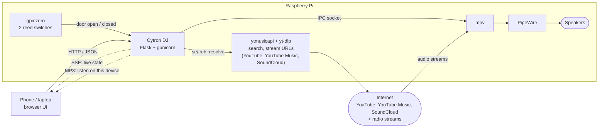

# Cytron DJ

A web app that turns a Raspberry Pi into a network music player. Open it from any phone or computer on the
network to play **internet radio**, **YouTube Music**, **YouTube** and **SoundCloud** through the Pi's speakers, and to see whether the
**restrooms are occupied** from magnetic door sensors. The door sensors can also drive the music: play while
someone is inside, pause when everyone has left.



New here? Start with the [user guide](docs/user-guide.md). Setting it up? See [Quick start](#quick-start) and
[deployment](docs/deployment.md).

## Features

| Area | What it does |
|---|---|
| **Radio** | Stations grouped by category (Popular, Chinese, Tamil, RTM, community, ...) with logos, a search box and a grid / list layout. One tap plays. Add, rename, re-point or remove stations. |
| **Music** | A **Music home** that searches YouTube Music, YouTube and SoundCloud at once (tabs per platform), plus a page for each: YouTube Music songs and charts, a YouTube video grid, SoundCloud tracks. **Trending now** and **Suggested for you** shelves, recent searches. |
| **Queue** | Play next / previous, drag to reorder, remove, filter, clear, and play on automatically. Shuffle and repeat (off / all / one). |
| **Playlists** | Save the queue or single songs as named playlists, then play them any time. |
| **Player** | A floating mini player that opens into a card (desktop): artwork, live radio track title, seek bar, volume, up-next preview. Mini player and swipe-down sheet on mobile. |
| **Listen on this device** | A switch in the player that streams what the Pi is playing to your phone or laptop (up to 4 listeners). |
| **Restrooms** | Live Available / Occupied cards, how long each state has lasted, and a "check sensor" warning. |
| **Door autoplay** | Optional: play the queue while a door is closed during opening hours (it fades in gradually), pause when both are open. |
| **Door announcements** | A spoken welcome when a door closes ("Thank you for choosing Cytron DJ. Enjoy the vibe!") and a reminder when it opens ("Please remember to flush and keep it clean."). Messages are editable. |
| **Settings** | Door sensor pins, autoplay, fade-in, announcements and opening hours, and **Clear history**. |
| **System** | Reboot and Shut down buttons (with confirmation) in the sidebar. |
| **Live UI** | Every open browser updates instantly through server-sent events, and says so when it loses the connection. |
| **Resilient** | Restarts mpv if it dies, skips broken tracks, reconnects dropped radio streams, keeps the queue across restarts, backs up its data nightly. See [what happens when something fails](docs/deployment.md#what-happens-when-something-fails). |
| **Installable** | Web-app manifest and icons, light and dark theme. No offline mode: service workers need HTTPS and the app is served over plain HTTP on the LAN. |

## Quick start

```bash
sudo apt install mpv ffmpeg espeak-ng python3-gpiozero python3-lgpio quickjs   # player, "listen" encoder, door announcements, GPIO, JS runtime for yt-dlp
cd /home/pi/Documents/pi-player
python3 -m venv --system-site-packages .venv                        # system-site-packages: gpiozero comes from apt
.venv/bin/pip install -r requirements.txt
.venv/bin/python -m piplayer                                        # http://cytrondj.local:8088 (development server)
```

`ffmpeg` is only needed for **Listen on this device**, `espeak-ng` only for the spoken door announcements. To run on boot with the production server (gunicorn, port 80,
`http://cytrondj.local`), install the nightly backup and the weekly `yt-dlp` update, see [deployment](docs/deployment.md).

## Documentation

| Document | For | Contents |
|---|---|---|
| [docs/user-guide.md](docs/user-guide.md) | Everyone | How to use each tab, tips, what to do when something looks wrong |
| [docs/deployment.md](docs/deployment.md) | Whoever runs the Pi | Install, systemd service, audio output, backups, updates, failure behaviour, troubleshooting |
| [docs/configuration.md](docs/configuration.md) | Whoever runs the Pi | Environment variables and every data file |
| [docs/door-sensors.md](docs/door-sensors.md) | Whoever wires the doors | Wiring, occupancy, autoplay rules, watchdog, troubleshooting |
| [docs/architecture.md](docs/architecture.md) | Developers | Components, threads, data flow, resilience, file layout |
| [docs/api.md](docs/api.md) | Developers | Every HTTP endpoint, the state object and the live event stream |
| [docs/development.md](docs/development.md) | Developers | Running and testing, conventions, how to extend the app |
| [CHANGELOG.md](CHANGELOG.md) | Everyone | What changed and when |

## Requirements

- Raspberry Pi running Raspberry Pi OS (Bookworm or later) with audio working through PipeWire
- `mpv`, Python 3.11+, and the packages in [requirements.txt](requirements.txt) (`requirements.lock` lists the exact versions that were tested)
- `ffmpeg` and `pw-record` (PipeWire) for Listen on this device
- For the door sensors: `python3-gpiozero` and `python3-lgpio` (system packages) and two reed switches

## Security note

The app has **no login**. Anyone who can reach the Pi on the network can play music, change settings and reboot
or shut down the Pi. Run it only on a trusted network, never forwarded to the internet.

Protections that are in place (they are not authentication): every `/api` request must use a LAN-style hostname
or IP in its `Host` header (blocks DNS-rebinding), writes from another website are refused, queue items are
validated so mpv only ever opens `http(s)` streams and plain YouTube ids, and the power endpoints refuse non-JSON
requests. Details in [api.md](docs/api.md#validation-and-the-request-guard).
