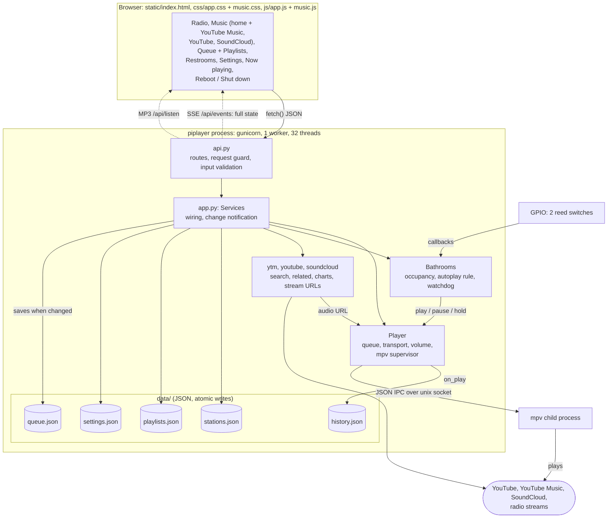
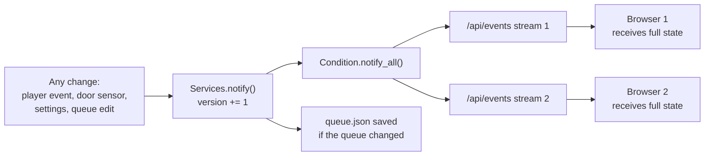

# Architecture

Cytron DJ is a single Python process that owns one `mpv` child process, a small set of JSON files, and optionally
two GPIO inputs. In production gunicorn runs it with **one worker and 32 threads** (the player lives inside the
process, so there must be exactly one worker). The browser UI is plain HTML, CSS and JavaScript with no build step.

## Overview



## Services

`app.create_app()` builds a `Services` object, stores it in `app.extensions["piplayer"]`, registers the API
blueprint and starts the bathroom service. Routes reach it through `current_app.extensions["piplayer"]`.
`piplayer/wsgi.py` exposes `app` for gunicorn; `python -m piplayer` runs the Flask development server.

| Service | Module | Responsibility |
|---|---|---|
| **Services** | [app.py](../piplayer/app.py) | Owns the other services. `notify()` bumps a version counter, wakes every waiting event stream and saves the queue if it changed. Registers flush-on-exit for the settings files. |
| **Player** | [player.py](../piplayer/player.py) | The queue and playback. Starts and supervises `mpv`, sends it commands and reads its events over a unix-socket JSON IPC. See below. |
| **StationStore** | [stations.py](../piplayer/stations.py) | The radio station list in `data/stations.json`. Seeded from `piplayer/defaults/stations.json` on first run; a damaged file is set aside and the defaults restored. |
| **PlaylistStore** | [playlists.py](../piplayer/playlists.py) | Saved playlists in `data/playlists.json`. Also holds `clean_items()`, the validator every queue item passes through. |
| **HistoryStore** | [history.py](../piplayer/history.py) | Play counts and last-played times per YouTube Music track in `data/history.json` (newest 300). Feeds Recently played, Mostly played and the seeds for Suggested. |
| **Settings** | [settings.py](../piplayer/settings.py) | Small key/value store with debounced (1 s), atomic writes and a `flush()`. Two instances: `settings.json` (door config, volume) and `queue.json` (saved queue). |
| **youtube** | [youtube.py](../piplayer/youtube.py) | `search()` (yt-dlp `ytsearch`) for the whole of YouTube and `resolve()` for an 11 character video id (cached 3 hours). |
| **soundcloud** | [soundcloud.py](../piplayer/soundcloud.py) | `search()` (yt-dlp `scsearch`, 30-second major-label previews dropped) and `resolve()` for a validated `soundcloud.com` permalink (cached 30 minutes). |
| **speech** | [speech.py](../piplayer/speech.py) | Text to speech for the door announcements. **Piper** (neural, natural; falls back to `espeak-ng`) renders each message once into `data/speech-cache/` with silence at both ends, so at the door it is just a file played by `pw-play` / `aplay` through the same speakers (argv lists, no shell). `prepare()` renders ahead of time, `available()` / `engine()` report what can work. |
| **ytm** | [ytm.py](../piplayer/ytm.py) | `search()` through ytmusicapi (unauthenticated). `resolve()` turns a video id into a direct audio URL with yt-dlp (cached 3 h, expired entries evicted). `suggest()` returns related tracks (cached 10 min). `trending()` returns the country chart (cached 1 h). |
| **Bathrooms** | [bathrooms.py](../piplayer/bathrooms.py) | Door sensors, occupancy, the autoplay rule and the sensor watchdog. See [door-sensors.md](door-sensors.md). |
| **Config** | [config.py](../piplayer/config.py) | Immutable settings read once from `PIPLAYER_*` environment variables. |
| **API** | [api.py](../piplayer/api.py) | All HTTP routes. See [api.md](api.md). |

### Player and mpv

`Player` launches one long-lived `mpv --idle=yes --no-video` and talks to it through the IPC socket
(`PIPLAYER_SOCKET`). It subscribes to mpv properties (`pause`, `volume`, `time-pos`, `duration`, `metadata`,
`idle-active`, `core-idle`) and mirrors them into a state dictionary under a lock. Every change calls `on_change`,
which is `Services.notify`.

- **Queue items** are `{kind, id, title, ...}`. `kind` is `radio` (has a `url`), `ytm` (YouTube Music), `yt` (YouTube, 11 character video id) or `sc` (SoundCloud: numeric id plus a `soundcloud.com` permalink in `url`). Everything except `radio` is resolved to a stream URL at play time. All input passes `clean_items()` first.
- **Generation counter.** Each play request bumps `_gen`. A slow URL resolution, retry or prefetch that finishes after the user has moved on is discarded.
- **Auto-advance.** On `end-file` with reason `eof` the player moves to the next item (respecting shuffle and repeat). At the end of the queue it stops.
- **Volume** is the **system** volume (PipeWire default sink via `wpctl`), not mpv's: mpv is pinned at 100 %. Requests coalesce so a slider drag is latest-wins. The sink is polled every 2 s for outside changes, but only while a browser holds an event stream (`Player.watchers`).
- **Hold.** For live radio the autoplay rule *silences* the stream (`mute`) instead of pausing it, because a paused radio stream is dropped by the server within about a minute. `held` is reported to clients as `paused`.
- **Shuffle** keeps a set of items already heard this round and a history for Previous.

### Resilience

| Mechanism | How it works |
|---|---|
| **mpv supervision** | The `mpv-reader` thread notices the socket closing and `_mpv_died` marks the state (`error: "Audio engine restarted"`), then `mpv-respawn` restarts mpv with backoff (1 s, doubling to 30 s) and replays the current track. More than 3 crashes in 60 s: mpv is still restarted but playback is not auto-resumed. `_send` returns `False` instead of raising while mpv is down. |
| **Failed tracks** | A resolve error or mpv `error` event calls `_track_failed`: the track is skipped. A streak as long as the queue stops playback (so a queue of broken tracks cannot loop). The streak resets on mpv's `file-loaded` event. |
| **Dropped radio streams** | A live stream that ends with `eof` (or errors) is reconnected up to `RADIO_RETRIES` (3) times, waiting 2, 4, 6 s. The counter resets when a stream loads successfully, then falls through to the failed-track path. |
| **Prefetch** | Once a YouTube / YouTube Music / SoundCloud track starts, the next one is resolved in a `prefetch` thread (the resolver caches the URL), so songs follow each other without a gap. Skipped with shuffle or repeat-one. |
| **Queue persistence** | `Services.notify` compares the queue, index, repeat and shuffle with the last saved copy and, if changed, hands them to the `queue.json` `Settings`. On start `Player.restore()` loads them **without playing**. |
| **History** | `Player.on_play` is called when a track is handed to mpv; exceptions from it are swallowed so history can never break playback. |
| **Atomic files** | Every JSON file is written to a temp file and renamed. `Settings` also flushes on exit (`atexit`). |
| **Request guard** | See [api.md](api.md#validation-and-the-request-guard). |

### Suggested music

`GET /api/suggested` asks `HistoryStore.seeds()` for the favourite and the latest track, fetches YouTube Music's
related tracks for them (`ytm.suggest`) and the country chart (`ytm.trending`: the first playlist from
`get_charts`, e.g. "Trending 20 Malaysia"), removes anything played recently and alternates the two lists. Each
source failing is tolerated; with no history the chart is used alone, and a "top hits" search is the last resort.

### Listen on this device

`GET /api/listen` starts `pw-record` (capturing the default sink's monitor, before the system volume) piped into
`ffmpeg` (MP3, 128 kbit/s) and streams the result. A semaphore allows 4 listeners; the child processes are killed
when the client disconnects.

### Change notification



Each event stream sends the **complete state**, not a diff, so a client that reconnects is correct immediately.
A `: keepalive` comment is sent every 15 s when nothing changes.

## Threads

| Thread | Started by | Purpose |
|---|---|---|
| Request threads | gunicorn `gthread` (1 worker, 32 threads); `python -m piplayer` uses Flask `threaded=True` | One per request. Each open event stream and each "listen" stream holds one for as long as it is open. |
| `mpv-reader` | `Player._start_mpv` | Reads mpv IPC events and updates state. One per mpv process. |
| `mpv-respawn` | `Player._mpv_died` | Restarts mpv after a crash. |
| load threads | `Player.play_index` | Resolve a URL (may take seconds for YouTube) without blocking requests. |
| `prefetch` | `Player._prefetch` | Resolves the next YouTube track ahead of time. |
| `radio-retry` | `Player._retry_stream` | Waits, then reconnects a dropped live stream. |
| `sys-volume` | `Player` | Applies volume changes (`wpctl`) and polls for outside changes while a browser is watching. |
| `bathrooms` ticker | `Bathrooms.run` | Every 20 s: re-evaluates autoplay (catches opening and closing time) and pushes the sensor-watchdog flag. |
| gpiozero callbacks | gpiozero | Called when a door switch changes state. |
| settings timers | `Settings.update` | Write a JSON file 1 s after the last change. |

## Front end

[static/index.html](../piplayer/static/index.html), [css/app.css](../piplayer/static/css/app.css) and
[js/app.js](../piplayer/static/js/app.js). The CSS uses shadcn / ReUI design tokens (`--primary`, `--muted`,
`--radius`, ...) with a light and a dark theme.

- On load the page fetches `/api/stations` and `/api/state`, renders, then opens `EventSource('/api/events')`. Every message replaces the in-memory state `S` and calls `render()`. If the stream drops, a toast says so; the browser reconnects by itself and the first message re-syncs everything.
- `api()` returns `{error}` for a non-JSON reply (such as a 500 page) instead of throwing.
- Navigation is tabs (sidebar on desktop, bottom bar on mobile). Browser-only preferences live in `localStorage`: `cdj-tab` (selected tab), `cdj-theme`, `cdj-recent` (recent searches), `cdj-mview` (grid / list per Music platform page), `cdj-stview` (radio layout).
- **Music** is built by [js/music.js](../piplayer/static/js/music.js) (styles in [css/music.css](../piplayer/static/css/music.css)); the panes `music`, `ytm`, `yt` and `sc` are empty in `index.html` and filled on first visit. The home page searches all three platforms in parallel (`/api/search` with `source=` omitted, `youtube`, `soundcloud`) and fills each section as its source answers; the platform pages search one source. Idle shelves: **Trending now** (`/api/trending`) and **Suggested for you** (`/api/suggested`, loaded separately so it never delays the rest). A newer search always discards the answers of an older one.
- **Radio** groups stations by their `category` and filters them in place (cards are hidden, not rebuilt, so playback state never flickers).
- **Now playing** is one fixed card. On desktop it is a floating mini player that opens into a card in the same corner: the card's width / height / radius are CSS transitions and the cover is flown between its two sizes with the Web Animations API (`npMorph` in `app.js`) using the same duration and easing. On mobile it is a mini player plus an expandable full-screen sheet. **Listen on this device** plays `/api/listen` in an `Audio` element and reconnects after 2 s if it drops.
- The Settings form is filled from `S.doors` (it arrives with the normal state stream) and saved with `POST /api/doors`.
- No framework, no bundler, no external requests apart from station artwork, YouTube thumbnails and the streams themselves.

## File layout

```
pi-player/
├── README.md, CHANGELOG.md
├── docs/                        this documentation
├── requirements.txt             flask, gunicorn, ytmusicapi, yt-dlp
├── requirements.lock            exact versions that were tested
├── requirements-dev.txt         + pytest
├── pytest.ini
├── deploy/
│   ├── piplayer.service         systemd unit (gunicorn)
│   ├── backup.sh                archive data/, keep 14
│   ├── update-deps.sh           upgrade yt-dlp and ytmusicapi
│   ├── piplayer-backup.{service,timer}, piplayer-update.{service,timer}
│   └── install-maintenance.sh   installs both timers (sudo)
├── data/                        runtime state, git-ignored
│   ├── stations.json, playlists.json, history.json, settings.json, queue.json
├── piplayer/
│   ├── __main__.py              `python -m piplayer` (development server)
│   ├── wsgi.py                  `gunicorn piplayer.wsgi:app`
│   ├── app.py                   app factory, Services
│   ├── api.py                   HTTP routes, request guard
│   ├── bathrooms.py             door sensors, autoplay, watchdog
│   ├── config.py                environment configuration
│   ├── history.py               play history
│   ├── player.py                mpv player, queue, supervision
│   ├── playlists.py             playlist store, item validation
│   ├── settings.py              persisted settings
│   ├── stations.py              station store
│   ├── ytm.py                   YouTube Music search, related, charts, stream URLs
│   ├── speech.py                text to speech (Piper, espeak-ng fallback) for door announcements
│   ├── youtube.py               YouTube search + stream URLs (yt-dlp)
│   ├── soundcloud.py            SoundCloud search + stream URLs (yt-dlp)
│   ├── defaults/stations.json   seed list of 32 stations
│   └── static/                  index.html, css/ (app, music), js/ (app, music), brand/ (icons), logos/ (stations), manifest
└── tests/                       pytest suite with a fake mpv; tests/frontend/ holds the Node harness for music.js
```
