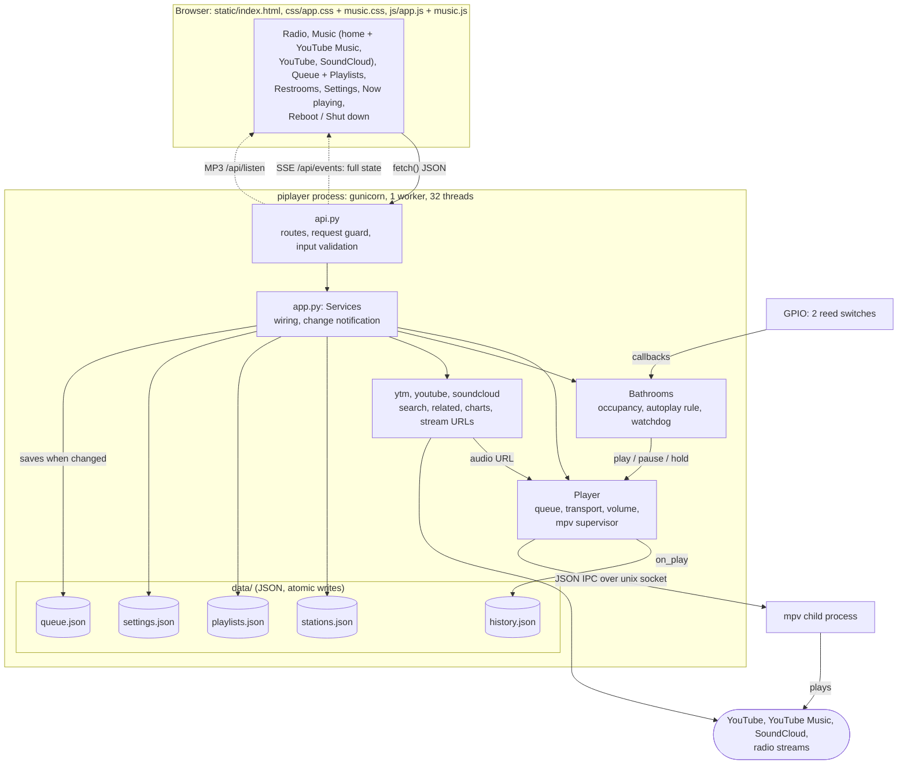
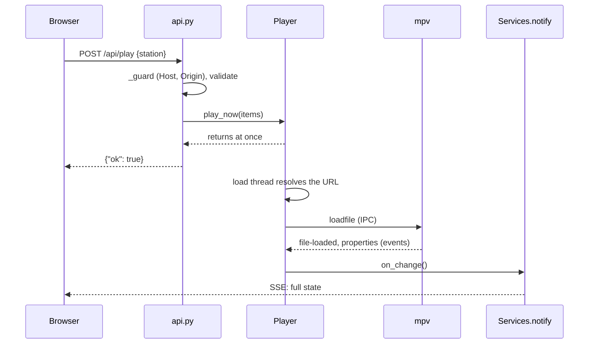
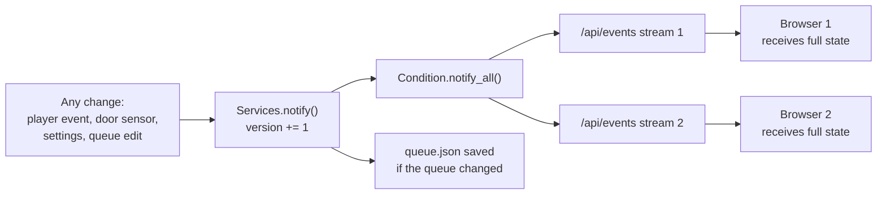

# Architecture overview

Cytron DJ is a single Python process that owns one `mpv` child process, a small set of JSON files, and optionally
two GPIO inputs. In production gunicorn runs it with **one worker and 32 threads** (the player lives inside the
process, so there must be exactly one worker). The browser UI is plain HTML, CSS and JavaScript with no build step.

More detail: [Player and playback](player.md), [Front end](frontend.md), [Design decisions](decisions.md).

## The big picture



## System context

| Neighbour | How the app talks to it |
|---|---|
| Browsers on the LAN | HTTP + JSON, one server-sent event stream each, optional MP3 stream |
| `mpv` | Child process, JSON IPC over a unix socket (`PIPLAYER_SOCKET`) |
| PipeWire | `wpctl` (volume), `pw-record` (Listen), `pw-play` (announcements); mpv plays to its default sink |
| Reed switches | `gpiozero` / `lgpio` callbacks |
| YouTube Music | `ytmusicapi` (unauthenticated search, related, charts); `yt-dlp` for the stream |
| YouTube, SoundCloud | `yt-dlp` for search and stream |
| Radio stations | mpv opens the stream URL directly |
| systemd | Starts and restarts the service; runs the backup and update timers |

## Services

`app.create_app()` builds a `Services` object, stores it in `app.extensions["piplayer"]`, registers the API blueprint
and starts the bathroom service. Routes reach it through `current_app.extensions["piplayer"]`.
`piplayer/wsgi.py` exposes `app` for gunicorn; `python -m piplayer` runs the Flask development server.

| Service | Module | Responsibility |
|---|---|---|
| **Services** | [app.py](../../piplayer/app.py) | Owns the other services. `notify()` bumps a version counter, wakes every waiting event stream and saves the queue if it changed. Registers flush-on-exit for the settings files. Resolves a queue item to a stream URL by `kind`. |
| **Player** | [player.py](../../piplayer/player.py) | The queue and playback. Starts and supervises `mpv`, sends it commands and reads its events over a unix-socket JSON IPC. See [Player and playback](player.md). |
| **StationStore** | [stations.py](../../piplayer/stations.py) | The radio station list in `data/stations.json`. Seeded from `piplayer/defaults/stations.json` on first run; a damaged file is set aside and the defaults restored. |
| **PlaylistStore** | [playlists.py](../../piplayer/playlists.py) | Saved playlists in `data/playlists.json`. Also holds `clean_items()`, the validator every queue item passes through. |
| **HistoryStore** | [history.py](../../piplayer/history.py) | Play counts and last-played times per YouTube Music track in `data/history.json` (newest 300). Feeds Recently played, Mostly played and the seeds for Suggested. |
| **Settings** | [settings.py](../../piplayer/settings.py) | Small key/value store with debounced (1 s), atomic writes and a `flush()`. Two instances: `settings.json` (door config, volume) and `queue.json` (saved queue). |
| **ytm** | [ytm.py](../../piplayer/ytm.py) | `search()` through ytmusicapi (unauthenticated). `resolve()` turns a video id into a direct audio URL with yt-dlp (cached 3 h, expired entries evicted). `suggest()` returns related tracks (cached 10 min). `trending()` returns the country chart (cached 1 h). |
| **youtube** | [youtube.py](../../piplayer/youtube.py) | `search()` (yt-dlp `ytsearch`) for the whole of YouTube and `resolve()` for an 11 character video id (cached 3 hours). |
| **soundcloud** | [soundcloud.py](../../piplayer/soundcloud.py) | `search()` (yt-dlp `scsearch`, 30-second major-label previews dropped) and `resolve()` for a validated `soundcloud.com` permalink (cached 30 minutes). |
| **speech** | [speech.py](../../piplayer/speech.py) | Text to speech for the door announcements. **Piper** (neural; falls back to `espeak-ng`) renders each message once into `data/speech-cache/` with silence at both ends, so at the door it is just a file played by `pw-play` / `aplay` (argv lists, no shell). `prepare()` renders ahead of time, `available()` / `engine()` report what can work. |
| **Bathrooms** | [bathrooms.py](../../piplayer/bathrooms.py) | Door sensors, occupancy, the autoplay rule, fades, announcements and the sensor watchdog. See [Door sensors](../doors/hardware.md). |
| **Config** | [config.py](../../piplayer/config.py) | Immutable settings read once from `PIPLAYER_*` environment variables. |
| **API** | [api.py](../../piplayer/api.py) | All HTTP routes. See [HTTP API](../reference/api.md). |

## Request lifecycle



A request never waits for audio: it returns as soon as the work is queued, and the browser learns the outcome from the
event stream.

## Change notification



Each event stream sends the **complete state**, not a diff, so a client that reconnects is correct immediately. A
`: keepalive` comment is sent every 15 s when nothing changes. The state is built by `api._snapshot()` from
`player.snapshot()`, `bathrooms.snapshot()` and `bathrooms.config()`; the shape is documented in
[HTTP API](../reference/api.md#the-state-object).

## Threads

| Thread | Started by | Purpose |
|---|---|---|
| Request threads | gunicorn `gthread` (1 worker, 32 threads); `python -m piplayer` uses Flask `threaded=True` | One per request. Each open event stream and each "listen" stream holds one for as long as it is open. |
| `mpv-reader` | `Player._start_mpv` | Reads mpv IPC events and updates state. One per mpv process. |
| `mpv-respawn` | `Player._mpv_died` | Restarts mpv after a crash. |
| load threads | `Player.play_index` | Resolve a URL (may take seconds for YouTube) without blocking requests. |
| `prefetch` | `Player._prefetch` | Resolves the next track ahead of time. |
| `radio-retry` | `Player._retry_stream` | Waits, then reconnects a dropped live stream. |
| `sys-volume` | `Player` | Applies volume changes (`wpctl`) and polls for outside changes while a browser is watching. |
| `bathrooms` ticker | `Bathrooms.run` | Every 20 s: re-evaluates autoplay (catches opening and closing time) and pushes the sensor-watchdog flag. |
| fade threads | `Bathrooms` | Fade in, fade out and ducking ramps. |
| gpiozero callbacks | gpiozero | Called when a door switch changes state. |
| settings timers | `Settings.update` | Write a JSON file 1 s after the last change. |

Shared state is guarded by locks (`Player.lock`, the `Services.changed` condition, one lock per store). Because there is
one process, in-memory state is the source of truth and the files are only for persistence.

## Failure containment

| Layer | Rule |
|---|---|
| Hardware and subprocesses | Never raise into the app. GPIO failures become `doors.error`; `Player._send` returns `False` while mpv is down; speech failures are logged. |
| Network sources | Any one of YouTube Music, YouTube or SoundCloud failing must not break the others (search answers per source; Suggested tolerates a failing half). |
| Files | Atomic writes; a corrupt `stations.json` is set aside and replaced. |
| Requests | Bad input is a 400, never a 500. |
| Playback | See [Resilience](player.md#resilience). |

## File layout

```
pi-player/
├── README.md, CHANGELOG.md, LICENSE
├── docs/                        this documentation (see docs/README.md)
├── requirements.txt             flask, gunicorn, ytmusicapi, yt-dlp, piper-tts
├── requirements.lock            exact versions that were tested
├── pyproject.toml               pytest settings
├── deploy/
│   ├── piplayer.service         systemd unit (gunicorn)
│   ├── backup.sh                archive data/, keep 14
│   ├── update-deps.sh           upgrade yt-dlp and ytmusicapi
│   ├── piplayer-backup.{service,timer}, piplayer-update.{service,timer}
│   └── install-maintenance.sh   installs both timers (sudo)
├── data/                        runtime state, git-ignored
│   ├── stations.json, playlists.json, history.json, settings.json, queue.json
│   └── voices/, speech-cache/
├── piplayer/
│   ├── __main__.py              `python -m piplayer` (development server)
│   ├── wsgi.py                  `gunicorn piplayer.wsgi:app`
│   ├── app.py                   app factory, Services
│   ├── api.py                   HTTP routes, request guard
│   ├── bathrooms.py             door sensors, autoplay, fades, announcements, watchdog
│   ├── config.py                environment configuration
│   ├── history.py               play history
│   ├── player.py                mpv player, queue, supervision
│   ├── playlists.py             playlist store, item validation
│   ├── settings.py              persisted settings
│   ├── stations.py              station store
│   ├── speech.py                text to speech (Piper, espeak-ng fallback)
│   ├── ytm.py                   YouTube Music search, related, charts, stream URLs
│   ├── youtube.py               YouTube search + stream URLs (yt-dlp)
│   ├── soundcloud.py            SoundCloud search + stream URLs (yt-dlp)
│   ├── defaults/stations.json   seed list of 71 stations
│   └── static/                  index.html, css/ (app, music), js/ (app, music), brand/ (icons), logos/ (stations), manifest
└── tests/                       pytest suite with a fake mpv; tests/frontend/ holds the Node harness for music.js
```
