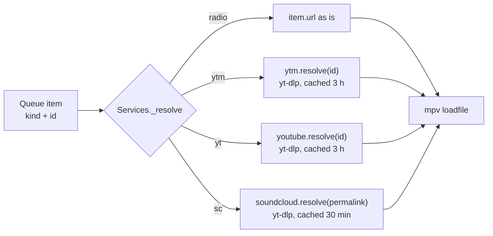
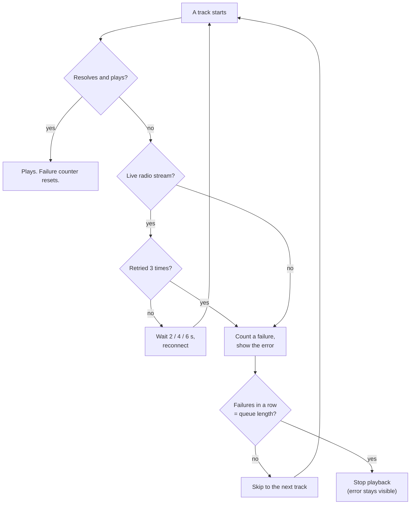

# Player and playback

How the queue, mpv and the music sources fit together, and how playback survives failures. Code:
[piplayer/player.py](../../piplayer/player.py).

## Player and mpv

`Player` launches one long-lived `mpv --idle=yes --no-video` and talks to it through the IPC socket
(`PIPLAYER_SOCKET`). It subscribes to mpv properties (`pause`, `volume`, `time-pos`, `duration`, `metadata`,
`idle-active`, `core-idle`) and mirrors them into a state dictionary under a lock. Every change calls `on_change`,
which is `Services.notify`.

- **Queue items** are `{kind, id, title, ...}`. `kind` is `radio` (has a `url`), `ytm` (YouTube Music), `yt` (YouTube,
  11 character video id) or `sc` (SoundCloud: numeric id plus a `soundcloud.com` permalink in `url`). Everything
  except `radio` is resolved to a stream URL at play time. All input passes `clean_items()` first.
- **Generation counter.** Each play request bumps `_gen`. A slow URL resolution, retry or prefetch that finishes
  after the user has moved on is discarded.
- **Auto-advance.** On `end-file` with reason `eof` the player moves to the next item (respecting shuffle and
  repeat). At the end of the queue it stops.
- **Volume** is the **system** volume (PipeWire default sink via `wpctl`), not mpv's: mpv is pinned at 100 %.
  Requests coalesce so a slider drag is latest-wins. The sink is polled every 2 s for outside changes, but only while
  a browser holds an event stream (`Player.watchers`). The announcement dip is the exception: it uses mpv's own volume.
- **Hold.** For live radio the autoplay rule *silences* the stream (`mute`) instead of pausing it, because a paused
  radio stream is dropped by the server within about a minute. `held` is reported to clients as `paused`.
- **Shuffle** keeps a set of items already heard this round and a history for Previous.
- **Previous** restarts the current item if more than 5 s in (or it is the first); otherwise goes back one.

## Music sources

| Source | Kind | Search | Stream URL | Notes |
|---|---|---|---|---|
| Radio | `radio` | (station list) | the station URL | Live; reconnects on drop; supports silence ("hold") |
| YouTube Music | `ytm` | `ytmusicapi` (unauthenticated) | `yt-dlp` | The only source recorded in history; also related tracks and the country chart |
| YouTube | `yt` | `yt-dlp ytsearch` | `yt-dlp` | Videos, live streams and podcasts, as audio |
| SoundCloud | `sc` | `yt-dlp scsearch` | `yt-dlp` on the permalink | 30-second major-label previews are dropped from results |

yt-dlp needs a JavaScript runtime for YouTube (`quickjs`). Stream URLs expire, hence the caches' lifetimes, and the
resolver retries are the player's job (see below).

### Suggested music

`GET /api/suggested` asks `HistoryStore.seeds()` for the favourite and the latest track, fetches YouTube Music's
related tracks for them (`ytm.suggest`) and the country chart (`ytm.trending`: the first playlist from `get_charts`,
e.g. "Trending 20 Malaysia"), removes anything played recently and alternates the two lists. Each source failing is
tolerated; with no history the chart is used alone, and a "top hits" search is the last resort.

### Listen on this device

`GET /api/listen` starts `pw-record` (capturing the default sink's monitor, before the system volume) piped into
`ffmpeg` (MP3, 128 kbit/s) and streams the result. A semaphore allows 4 listeners; the child processes are killed
when the client disconnects.

## Resilience

| Mechanism | How it works |
|---|---|
| **mpv supervision** | The `mpv-reader` thread notices the socket closing and `_mpv_died` marks the state (`error: "Audio engine restarted"`), then `mpv-respawn` restarts mpv with backoff (1 s, doubling to 30 s) and replays the current track. More than 3 crashes in 60 s: mpv is still restarted but playback is not auto-resumed. `_send` returns `False` instead of raising while mpv is down. |
| **Failed tracks** | A resolve error or mpv `error` event calls `_track_failed`: the track is skipped. A streak as long as the queue stops playback (so a queue of broken tracks cannot loop). The streak resets on mpv's `file-loaded` event. |
| **Dropped radio streams** | A live stream that ends with `eof` (or errors) is reconnected up to `RADIO_RETRIES` (3) times, waiting 2, 4, 6 s. The counter resets when a stream loads successfully, then falls through to the failed-track path. |
| **Prefetch** | Once a YouTube / YouTube Music / SoundCloud track starts, the next one is resolved in a `prefetch` thread (the resolver caches the URL), so songs follow each other without a gap. Skipped with shuffle or repeat-one. |
| **Queue persistence** | `Services.notify` compares the queue, index, repeat and shuffle with the last saved copy and, if changed, hands them to the `queue.json` `Settings`. On start `Player.restore()` loads them **without playing**. |
| **History** | `Player.on_play` is called when a track is handed to mpv; exceptions from it are swallowed so history can never break playback. |
| **Atomic files** | Every JSON file is written to a temp file and renamed. `Settings` also flushes on exit (`atexit`). |
| **Request guard** | See [Security](../admin/security.md#protections-that-are-built-in). |

What a user sees for each failure is listed in [Troubleshooting](../admin/troubleshooting.md).

| Failure | Behaviour |
|---|---|
| mpv crashes | Restarted within a second or two and the current track resumes (not if it crashed more than 3 times in a minute, then it just restarts) |
| A track cannot be resolved or played | Skipped. If every track in the queue fails in a row, playback stops with an error |
| A radio stream drops | Reconnected up to 3 times (2, 4, 6 s apart), then treated as a failed track |
| Browser loses the connection | A toast says so; it reconnects automatically and re-syncs |
| `stations.json` is corrupt | Kept as `stations.json.bad-<time>`; defaults restored |
| Power cut | JSON files are replaced atomically, so they are never half-written. The last second of changes may be lost. |
| The service restarts | The queue, position, repeat and shuffle come back, paused |

## Door control of the player

`Bathrooms` drives the player through its public methods only: play the current item, pause or resume, hold or
release a radio stream, stop, set the system volume for fades, and duck the music for announcements. It never reads
mpv directly. The rule and the fades are described in [Door autoplay](../doors/autoplay.md) and the speech path in
[Door announcements](../doors/announcements.md). The ticker runs every 20 s to catch the opening and closing times and
to push the watchdog flag.
