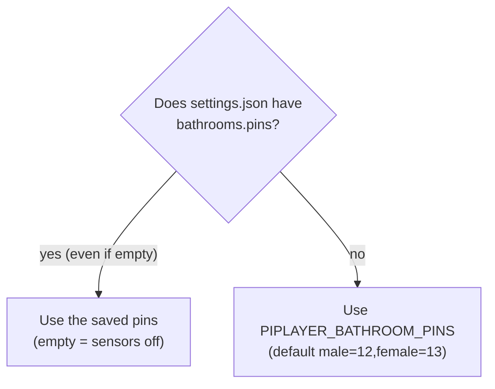

# Configuration

There are three places configuration lives:

1. **Environment variables** (`PIPLAYER_*`), read once at start-up. Set by hand or in the systemd unit.
2. **Settings changed in the web UI** (door sensors), stored in `data/settings.json`. They survive restarts.
3. **Data you build up** (stations, playlists, history, the queue), stored as JSON files in `data/`.

## Environment variables

| Variable | Default | Meaning |
|---|---|---|
| `PIPLAYER_HOST` | `0.0.0.0` | Address `python -m piplayer` listens on. `127.0.0.1` makes it local-only. (In production gunicorn's `--bind` in the unit decides.) |
| `PIPLAYER_PORT` | `8088` | Port for `python -m piplayer` (development). In production gunicorn binds the port in the systemd unit (`--bind 0.0.0.0:80`). |
| `PIPLAYER_DATA` | `./data` (next to the project) | Folder holding the JSON data files (below). Created if missing. |
| `PIPLAYER_MPV` | `mpv` | mpv command. May include arguments, e.g. `mpv --audio-device=alsa/plughw:2`. Parsed like a shell command line. |
| `PIPLAYER_SOCKET` | `/tmp/piplayer-mpv.sock` | Unix socket for the mpv IPC. Change it to run two instances side by side. |
| `PIPLAYER_BATHROOM_PINS` | `male=12,female=13` | **Initial** door sensor pins as `room=BCM,room=BCM`. An empty value (`PIPLAYER_BATHROOM_PINS=`) means no sensors. Pins saved from the Settings page take precedence. |
| `PIPLAYER_CHARTS_COUNTRY` | `MY` | Country of the trending chart mixed into Music > Suggested. Use a two-letter code such as `SG`, or `ZZ` for global. |
| `PIPLAYER_TTS` | (on) | Set to `off` to disable spoken announcements entirely (the test suite does). |
| `PIPLAYER_PIPER_VOICE` | `data/voices/en_GB-alan-medium.onnx` | Path of the Piper voice (needs its `.onnx.json` next to it). Piper is used whenever this file and `piper-tts` exist. |
| `PIPLAYER_VOICE_DIR` / `PIPLAYER_SPEECH_CACHE` | `data/voices` / `data/speech-cache` | Where voice files live / where rendered messages are cached (the newest 30 are kept). |
| `PIPLAYER_TTS_VOICE` | `en-us+f3` | The espeak-ng voice (the fallback engine) for announcements (`espeak-ng --voices` lists them; `+f1`..`+f5` and `+m1`..`+m7` pick a variant). |
| `PIPLAYER_ALLOWED_HOSTS` | (none) | Extra comma-separated hostnames the API accepts. IPs, `localhost`, `*.local` and bare names such as `cytrondj` are always accepted; anything else gets 403 (this blocks DNS-rebinding). Set it if you reach the Pi by a real domain name. |

Other variables the service relies on (set in [deploy/piplayer.service](../deploy/piplayer.service)):

| Variable | Why |
|---|---|
| `XDG_RUNTIME_DIR=/run/user/1000` | Lets mpv reach the user's PipeWire session. Needs `sudo loginctl enable-linger pi`. |
| `LG_WD=/tmp` | The `lgpio` library creates a notification pipe (`.lgd-nfy*`) in its working directory; this keeps it out of the project folder. |

### How pins are chosen



So the environment variable only sets the starting point. After you press **Save** in Settings the saved value wins.

## Data files (`data/`)

| File | Holds | Notes |
|---|---|---|
| `stations.json` | Radio stations | Seeded from the 71 built-in stations. A damaged file is renamed `stations.json.bad-<time>` and the defaults are restored. |
| `playlists.json` | Saved playlists | |
| `history.json` | Play counts and last-played time per YouTube Music track (newest 300) | Feeds Suggested for you (and `/api/history`). Reset it with **Settings > Clear history**, or delete the file. SoundCloud, YouTube and radio plays are not recorded. |
| `settings.json` | Door sensor configuration (and a `volume` key, see below) | Written atomically 1 s after the last change and again on shutdown. |
| `queue.json` | The queue, current position, repeat and shuffle | Restored (not auto-played) after a restart. Delete it for an empty queue. |

All of `data/` is archived nightly by `deploy/backup.sh`; see [deployment](deployment.md#backups-and-updates). Stop
the service before editing or deleting any of these files by hand.

### `settings.json`

```json
{
  "volume": 62,
  "bathrooms": {
    "pins": { "male": 12, "female": 13 },
    "autoplay": false,
    "from": "08:00",
    "to": "18:00"
  }
}
```

| Key | Default | Meaning |
|---|---|---|
| `bathrooms.pins` | absent (use the environment) | BCM pin per room. `{}` = sensors off. |
| `bathrooms.autoplay` | `false` | Door autoplay switch. |
| `bathrooms.from`, `bathrooms.to` | `08:00`, `18:00` | Opening hours (24-hour `HH:MM`). |
| `bathrooms.fade` | `5` | Seconds for the music to rise to your volume when a door starts it (`0` = off). |
| `bathrooms.announce` | `true` | Speak at the doors. |
| `bathrooms.welcome`, `bathrooms.reminder` | "Thank you for choosing Cytron DJ. Enjoy the vibe!", "Please remember to flush and keep it clean." | The spoken messages (max 160 characters, empty = none). |
| `volume` | `70` | Written whenever the volume changes, but **not read back**: the player always starts at 70 and sets the Pi's system volume to it. To change the starting level, edit `DEFAULT_VOLUME` in [player.py](../piplayer/player.py). |

### `stations.json`

The radio stations. Copied from `piplayer/defaults/stations.json` (71 stations) the first time the app runs. The
file is rewritten atomically whenever you add, edit or remove a station.

```json
[
  { "id": "hitz-fm", "title": "Hitz FM", "url": "https://stream.rcs.revma.com/488kt4sbv4uvv",
    "thumb": "/static/logos/hitz-fm.png" },
  { "id": "st1", "title": "My Station", "url": "https://example.com/stream.mp3" }
]
```

| Key | Required | Meaning |
|---|---|---|
| `id` | yes | Unique id. Stations added in the UI get `st1`, `st2`, ... |
| `title` | yes | Name shown on the card |
| `url` | yes | Direct stream URL (`mp3`, `aac`, `m3u8`). Must start with `http://` or `https://`. |
| `thumb` | no | Logo path under `/static/`. Without it the card shows the first letter of the title. |
| `category` | no | Heading the station is listed under on the Radio tab (for example `Popular`, `RTM Regional`). Stations without one appear last under **My stations**. Stations added in the UI have none yet; add it by editing the file. Editing a station in the UI keeps its category. |

To restore the built-in stations, stop the service and delete `data/stations.json`; it is re-created from the defaults
on the next start.

### `playlists.json`, `history.json`, `queue.json`

Written by the app; there is no reason to edit them by hand.

- `playlists.json`: a list of `{id, name, items, created}`. See [api.md](api.md#playlists) for the item format.
- `history.json`: an object keyed by YouTube video id, each with the track's details plus `plays` and `last` (Unix time).
- `queue.json`: `{queue, index, repeat, shuffle}`.

## Dependencies

[requirements.txt](../requirements.txt) lists the Python packages installed into the virtual environment.
[requirements.lock](../requirements.lock) records the exact versions that were tested (`pip freeze --local`).

| Package | Used for |
|---|---|
| `flask` | HTTP routing |
| `gunicorn` | Production server (one worker, threads) |
| `ytmusicapi` | YouTube Music search, related tracks and charts |
| `yt-dlp` | Searching YouTube and SoundCloud, and resolving YouTube / SoundCloud / YouTube Music items to a direct audio URL. Must stay current; see below. |

System packages installed with `apt`:

| Package | Used for |
|---|---|
| `mpv` | The audio player |
| `ffmpeg` | Encodes the "Listen on this device" stream (optional) |
| `pipewire` tools (`pw-record`, `wpctl`) | Capturing output for "listen", and setting the system volume. Present on Raspberry Pi OS Bookworm. |
| `python3-gpiozero`, `python3-lgpio` | Door sensors. The virtual environment must be created with `--system-site-packages` (or have `include-system-site-packages = true` in `.venv/pyvenv.cfg`). |
| `quickjs` | JavaScript runtime that yt-dlp needs for YouTube. The Raspberry Pi OS `nodejs` (v20) is too old: yt-dlp needs Node 22+, Deno or QuickJS. |

`yt-dlp` is kept up to date by a weekly timer (see [deployment](deployment.md#backups-and-updates)) because YouTube
changes break it from time to time.
