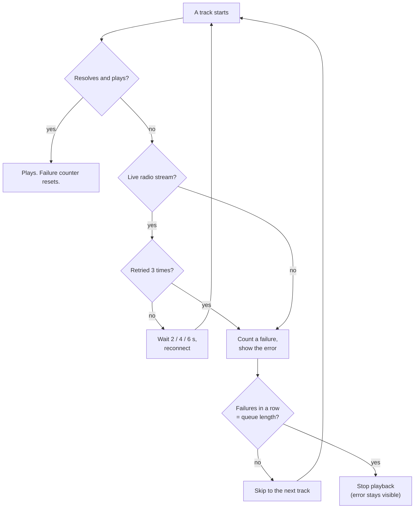

# Deployment

How to install Cytron DJ on a Raspberry Pi, run it on boot, and keep it healthy.

## 1. Install

```bash
sudo apt install mpv ffmpeg espeak-ng python3-gpiozero python3-lgpio quickjs   # espeak-ng = fallback voice
cd /home/pi/Documents/pi-player
python3 -m venv --system-site-packages .venv
.venv/bin/pip install -r requirements.txt
```

`--system-site-packages` lets the virtual environment use the `apt` GPIO libraries. If the environment already
exists without it, set `include-system-site-packages = true` in `.venv/pyvenv.cfg`. `ffmpeg` is only needed for
"Listen on this device".

Check it works by hand first (this uses Flask's development server, which is fine for a test):

```bash
.venv/bin/python -m piplayer          # then open http://cytrondj.local:8088
```

## 2. Run on boot (systemd)

The unit file [deploy/piplayer.service](../deploy/piplayer.service) runs the app under **gunicorn** as user `pi` from
`/home/pi/Documents/pi-player` on **port 80**, so the address is simply `http://cytrondj.local`.

```bash
sudo loginctl enable-linger pi        # keeps pi's PipeWire audio session alive without a login
sudo cp deploy/piplayer.service /etc/systemd/system/
sudo systemctl daemon-reload
sudo systemctl enable --now piplayer
```

If you install the project somewhere else, or use another user, edit `User=`, `WorkingDirectory=`,
`ExecStart=` and `XDG_RUNTIME_DIR=` (`/run/user/<uid>`) in the unit first.

What the unit sets:

| Line | Purpose |
|---|---|
| `After=network-online.target sound.target user@1000.service` | Start after the network and the user's audio session |
| `ExecStart=... gunicorn --workers 1 --worker-class gthread --threads 32 --bind 0.0.0.0:80 --timeout 120 --graceful-timeout 5 piplayer.wsgi:app` | Production server on port 80. **One worker only**: the player (mpv) lives inside the process. Threads serve browsers; live-update and listen streams each hold one. A restart waits at most 5 s for them to disconnect. |
| `AmbientCapabilities=CAP_NET_BIND_SERVICE` | Lets a non-root user bind port 80 |
| `Environment=XDG_RUNTIME_DIR=/run/user/1000` | mpv finds PipeWire |
| `Environment=LG_WD=/tmp` | Keeps the GPIO library's pipe out of the project folder |
| `Restart=always`, `RestartSec=5`, `TimeoutStopSec=15` | Restart after a crash or any unexpected exit |

Optional `Environment=` lines (commented in the unit): `PIPLAYER_BATHROOM_PINS`, `PIPLAYER_CHARTS_COUNTRY`,
`PIPLAYER_ALLOWED_HOSTS`. See [configuration.md](configuration.md).

Day-to-day commands:

```bash
sudo systemctl restart piplayer       # after changing code (run daemon-reload too after unit edits)
sudo systemctl status piplayer
journalctl -u piplayer -f             # live log
journalctl -u piplayer -n 100 --no-pager
```

Restarting stops the music for a few seconds; the queue comes back afterwards but is not played automatically.

## 3. Audio output

mpv plays to PipeWire's **default output**. On a Pi 4 that is usually the 3.5 mm headphone jack, but HDMI and
USB or Bluetooth outputs also appear.

```bash
export XDG_RUNTIME_DIR=/run/user/1000
wpctl status                          # the starred sink under "Sinks" is the default
wpctl set-default <sink-id>           # e.g. the HDMI sink
wpctl set-volume @DEFAULT_AUDIO_SINK@ 0.8
```

The volume slider in the app **is** the system output volume (the same one `wpctl` changes), so there is only one
volume to set. Each time the service starts it sets the volume to 70 %.

## Shutdown and reboot permissions

The Reboot and Shut down buttons call `systemctl poweroff` / `systemctl reboot` as the service user, and retry
with `sudo -n`. If the app answers *"Not allowed to shutdown..."*, grant `pi` permission with a sudoers rule:

```bash
echo 'pi ALL=(root) NOPASSWD: /usr/bin/systemctl poweroff, /usr/bin/systemctl reboot' \
  | sudo tee /etc/sudoers.d/piplayer >/dev/null \
  && sudo chmod 440 /etc/sudoers.d/piplayer \
  && sudo visudo -cf /etc/sudoers.d/piplayer
```

`visudo -cf` must print `parsed OK`. If it reports an error, delete the file with
`sudo rm /etc/sudoers.d/piplayer` immediately: a broken sudoers file can lock you out of `sudo`. Check the path
with `which systemctl` and use that path in the rule if it is not `/usr/bin/systemctl`.

## Backups and updates

Everything the app stores lives in `data/`. Two systemd timers keep it safe and keep YouTube playback working.
Install them once:

```bash
cd /home/pi/Documents/pi-player
sudo deploy/install-maintenance.sh      # installs and starts both timers
systemctl list-timers 'piplayer-*'
```

| Timer | When | What |
|---|---|---|
| `piplayer-backup` | every night 03:30 | [deploy/backup.sh](../deploy/backup.sh) archives `data/` to `~/backups/cytron-dj/data-YYYY-MM-DD.tar.gz` and keeps the newest 14 |
| `piplayer-update` | Sundays about 04:00 | [deploy/update-deps.sh](../deploy/update-deps.sh) upgrades `yt-dlp` and `ytmusicapi`, and restarts the service **only if** something changed |

**Manual backup:** `deploy/backup.sh` (set `BACKUP_DIR` to choose another folder).

**Restore a backup:**

```bash
sudo systemctl stop piplayer
tar -xzf ~/backups/cytron-dj/data-YYYY-MM-DD.tar.gz -C /home/pi/Documents/pi-player
sudo systemctl start piplayer
```

**Manual dependency update** (do this first when YouTube songs stop resolving):

```bash
cd /home/pi/Documents/pi-player
deploy/update-deps.sh && sudo systemctl restart piplayer
```

**After pulling new code:** run `.venv/bin/pip install -r requirements.txt`, re-copy the unit if `deploy/piplayer.service`
changed (`sudo cp` then `sudo systemctl daemon-reload`), restart the service, and hard-refresh open browser tabs
(Ctrl+Shift+R) so they load the new JavaScript. The project is a git repository (`data/` is ignored), and
`requirements.lock` records the exact package versions that were tested.

**Reset a piece of data** (stop the service first):

| File | Contains | To reset |
|---|---|---|
| `data/stations.json` | Your station list | Delete it; the 32 defaults are restored on the next start |
| `data/playlists.json` | Saved playlists | Delete it to remove all playlists |
| `data/history.json` | Play counts | Delete it to reset Recently / Mostly played and Suggested |
| `data/settings.json` | Door sensor settings | Delete it; defaults are used |
| `data/queue.json` | The saved queue | Delete it to start with an empty queue |

## What happens when something fails



| Failure | Behaviour |
|---|---|
| mpv crashes | Restarted within a second or two and the current track resumes (not if it crashed more than 3 times in a minute, then it just restarts) |
| A track cannot be resolved or played | Skipped. If every track in the queue fails in a row, playback stops with an error |
| A radio stream drops | Reconnected up to 3 times (2, 4, 6 s apart), then treated as a failed track |
| Browser loses the connection | A toast says so; it reconnects automatically and re-syncs |
| `stations.json` is corrupt | Kept as `stations.json.bad-<time>`; defaults restored |
| Power cut | JSON files are replaced atomically, so they are never half-written. The last second of changes may be lost. |
| The service restarts | The queue, position, repeat and shuffle come back, paused |

## Troubleshooting

| Symptom | Check |
|---|---|
| Page does not load | `systemctl status piplayer`, `journalctl -u piplayer -n 50`. Is `cytrondj.local` resolving? Try the Pi's IP address. |
| `unknown host` (403) in the browser or `curl` | The `Host` header is not a LAN name. Use the IP or `cytrondj.local`, or add your domain to `PIPLAYER_ALLOWED_HOSTS`. |
| Page loads but never updates until refreshed | The event stream is failing: `curl -N http://cytrondj.local/api/events` should stream `data:` lines, not an error page. |
| Press play, nothing is heard | `wpctl status` (right output? muted?), the volume, and `journalctl -u piplayer` for mpv errors. Confirm `loginctl show-user pi` shows `Linger=yes`. |
| Radio plays but YouTube music does not | Run the manual dependency update above. Install `quickjs` and restart. `WARNING: No supported JavaScript runtime` in the log means no usable runtime. |
| Music shows no Trending / Suggested shelves | The Pi cannot reach YouTube Music. Search will fail the same way; check the Pi's internet connection. |
| The SoundCloud or YouTube section of a search is empty | Check the Pi's internet connection, then update yt-dlp (`deploy/update-deps.sh`). SoundCloud also hides 30-second major-label previews on purpose. After deploying new code, restart the service: an old process answers `source=soundcloud` / `source=youtube` with YouTube Music results. |
| "Listen on this device" fails (503) | `pw-record` and `ffmpeg` must be installed (`sudo apt install ffmpeg`). A fifth simultaneous listener is refused. |
| `Audio engine restarted` appears | mpv crashed and was restarted; playback resumes by itself. If it repeats, look in `journalctl -u piplayer` and check the audio output. |
| Door messages are not spoken | Settings shows a notice if no voice is installed: see [Natural voice](door-sensors.md#the-voice) (Piper) or `sudo apt install espeak-ng`. Look in `journalctl -u piplayer` for `speech:` lines. Test the voice with the ▶ buttons (Settings > Announcements) or by hand: `espeak-ng -w /tmp/t.wav "hello" && pw-play /tmp/t.wav`. Also check the switch is on, the time is inside the active hours, and the message is not empty. |
| `mpv did not create its IPC socket` | mpv is not installed (`sudo apt install mpv`) or `PIPLAYER_MPV` is wrong. |
| Port 80 refused | The unit needs `AmbientCapabilities=CAP_NET_BIND_SERVICE`. When running by hand use the default port 8088. |
| Service keeps restarting | `journalctl -u piplayer -n 80`. A Python error at start shows there. Test by hand with `.venv/bin/python -m piplayer`. |
| Door sensor problems | See [door-sensors.md](door-sensors.md#troubleshooting). |
