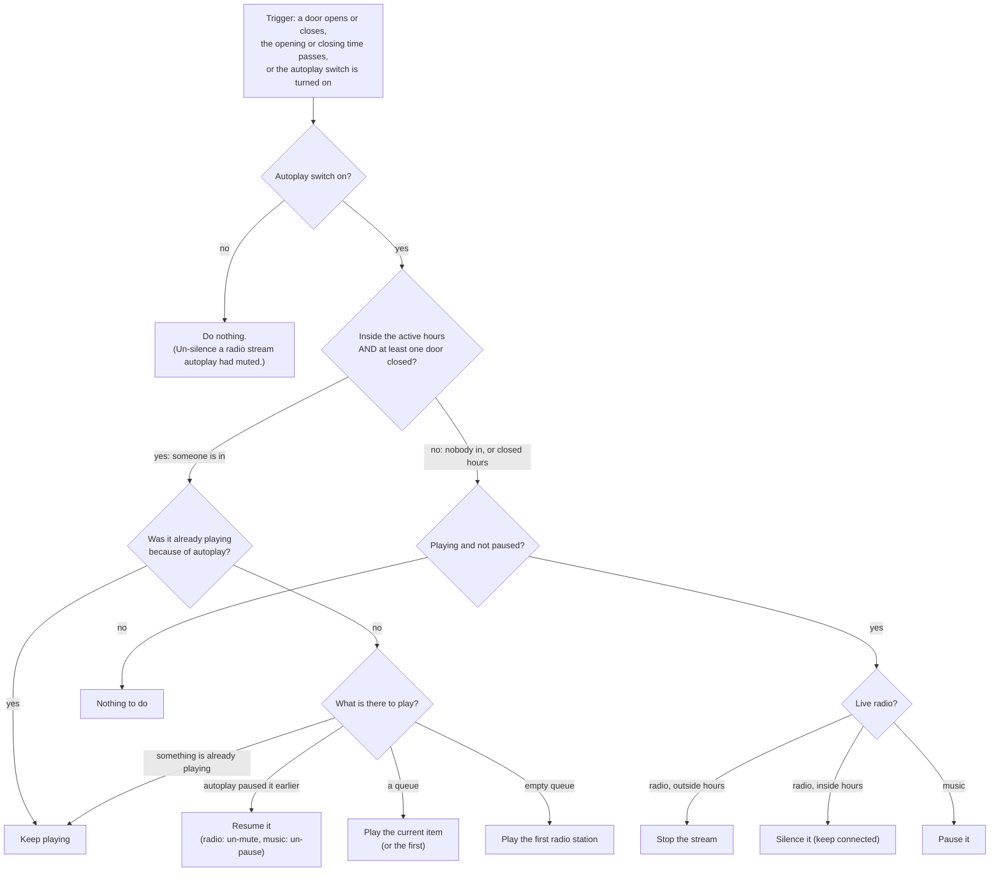

# Door sensors

The Pi can watch two bathroom doors with magnetic **reed switches**. The sensors give you:

1. **Occupancy**: live Available / Occupied cards on the Restrooms tab.
2. **Autoplay** (optional): music plays while someone is inside and pauses when nobody is.
3. **A sensor watchdog**: a "check sensor" warning if a switch seems stuck or unplugged.

Code: [piplayer/bathrooms.py](../piplayer/bathrooms.py). Settings page: **Settings** (section *Restroom door sensors*).

## Hardware

One reed switch per door, each between a GPIO pin and a ground pin. A magnet on the door keeps the switch
closed while the door is shut. No resistor is needed: the app turns on the Pi's internal pull-up.

```
 Pi GPIO pin ──── reed switch ──── GND         (one switch per door)
                       ▲
                  magnet on the door
```

| Room | Default BCM pin | Physical header pin | Nearby ground |
|---|---|---|---|
| male | 12 | 32 | 34 |
| female | 13 | 33 | 34 |

Pins are **BCM** (GPIO) numbers, 2 to 27, and must differ. Change them in Settings; no restart is needed.

How a reading is interpreted:

| Door | Magnet | Switch | Pin | Shown as |
|---|---|---|---|---|
| closed | next to switch | closed | low | **Occupied** |
| open | away | open | high | **Available** |
| sensor not configured / not started | | | | No sensor (grey) |

Mount the magnet so the switch is closed only when the door is shut. Debounce is 50 ms.

> **Limit of a plain reed switch.** A disconnected wire reads exactly like an open door, because the pull-up
> makes an unconnected pin read "high". Until a sensor is wired, clear both pin fields in Settings and press
> Save; the rooms then show **No sensor** instead of **Available**.

## Settings

On the Settings page:

| Control | Meaning |
|---|---|
| Male door / Female door (GPIO pin) | BCM pin of each switch. Leave both empty to switch the sensors off. |
| Play the queue while in use | The autoplay switch (off by default). |
| Active hours (from – to) | Opening hours. Used by autoplay, announcements and the watchdog. |
| Fade out | How long the music takes to fade down before it pauses when the last door opens (Off, 1 to 15 seconds; default 3). Only used with autoplay. The reminder is spoken after it. |
| Fade in | How long the music takes to rise to your volume when a door starts it (Off, 3 to 60 seconds; default 5). Only used with autoplay. |
| Speak at the doors | Switch for the spoken welcome / reminder (on by default). |
| Voice | Which voice reads the messages: *Automatic* (Piper if installed, else espeak-ng), or any installed voice. Changing it re-prepares the messages. |
| Music during a message | How loud the music stays while a message plays over it: No dip, 70 %, 50 %, 30 % (default), 15 %, Silent. |
| Music comes back | How long the music takes to return to full volume after a message: Instantly, 1, 2 (default), 4, 8 seconds. |
| Welcome / Reminder | The two messages (up to 160 characters; empty = say nothing). The ▶ button plays the saved message on the Pi's speakers. |
| Status badge | `N of 2 sensors active`, `No sensors`, or `Sensor error` with the reason below it. |

Saving restarts the sensors immediately. Changes apply immediately. The same settings are available through
[`POST /api/doors`](api.md#post-apidoors) and are stored in [`data/settings.json`](configuration.md).

## Autoplay

When the switch is on, the door sensors control playback during the opening hours.

| Situation | What happens |
|---|---|
| A door closes (someone enters) and nothing is playing | Plays the queue from the current item, or the first one. If the queue is empty it plays the first radio station. |
| A door closes and the music was paused by autoplay | **Resumes** it. |
| Both doors are open (nobody inside) | **Pauses** whatever is playing. |
| One door is still closed | Keeps playing. |
| The closing time passes | Pauses (music) or **stops** (radio, so it does not stream all night). |
| You switch autoplay **on** while both doors are open and music is playing | Pauses immediately. |
| You switch autoplay **off** | A radio stream that autoplay had silenced is un-silenced. Nothing else is touched from then on. |

### Fade-in

When a door closing **starts or resumes** the music (the first two rows above), the volume first drops to about 8 % of
your level and then rises to it over the *Fade in* time, instead of the music blasting in. The rise starts gently and speeds up, because loudness is felt logarithmically (a straight line sounds like a jump at the start). The volume you had set
is remembered and restored:

- If the door opens again halfway, the music pauses and the volume goes back to your level (so the next visit fades in
  again from the start).
- If you move the volume slider yourself during a fade, the fade stops and your value is kept.
- Set *Fade in* to **Off** for the old behaviour. It applies to music and radio alike (it changes the Pi's output volume).

### Fade-out

When the **last door opens**, the music no longer cuts off: the volume falls to about 8 % over the *Fade out* time (default 3
seconds), the music pauses (live radio is silenced), and the volume is put back to your level, ready for the next visit's fade-in.
The reminder is spoken after that, so it is never talked over by a dying track.

- If someone closes a door again during the fade-out, it is cancelled and the music carries on at your volume.
- If you move the volume slider during it, the music pauses at once and your value is kept.
- Set *Fade out* to **Off** to pause instantly. When the closing time passes the music fades out the same way.

## Announcements

Independent of autoplay, during the active hours the Pi can speak at the doors:

| Event | What is said (default text) |
|---|---|
| A door **closes** | "Thank you for choosing Cytron DJ. Enjoy the vibe!" Spoken first; if autoplay is on the music starts (and fades in) afterwards. |
| A door **opens** | "Please remember to flush and keep it clean." If that was the last occupied door the music has already paused; otherwise it is spoken over the music, which dips to about 30 % while the message plays. |

Rules: nothing is said at start-up or after rewiring the sensors, outside the active hours, when the switch is off, or when
that message is empty. Only one message plays at a time (a message that arrives while another is playing is skipped). If
the speakers or the speech engine fail, the door logic carries on silently.

### The voice

The voice is generated on the Pi, offline: nothing is sent anywhere.

| Engine | Sound | Install |
|---|---|---|
| **Piper** (preferred) | Natural, calm British male (`en_GB-alan-medium`) | `pip install piper-tts` in the project's venv (it is in `requirements.txt`), plus the voice files in `data/voices/` (below) |
| **espeak-ng** (fallback) | Robotic | `sudo apt install espeak-ng` |

Piper is used whenever its voice file is present, and espeak-ng takes over by itself if Piper fails.

```bash
cd ~/Documents/pi-player && mkdir -p data/voices && cd data/voices
B=https://huggingface.co/rhasspy/piper-voices/resolve/main/en/en_GB/alan/medium
curl -LO $B/en_GB-alan-medium.onnx && curl -LO $B/en_GB-alan-medium.onnx.json
```

Any other Piper voice works: download its `.onnx` and `.onnx.json` and set `PIPLAYER_PIPER_VOICE=/path/to/voice.onnx`
(browse them at [rhasspy/piper-voices](https://huggingface.co/rhasspy/piper-voices); check a voice's licence before using it).

**Rendered once, played instantly.** A message is turned into a WAV the first time (about 10 s for both messages on a Pi 4,
mostly loading the voice) and kept in `data/speech-cache/`. The app renders both messages in the background when it starts and
whenever you save a changed message, so at the door the message is just a file being played. Each file has a third of a second of
silence in front so the speakers cannot swallow the first word.

**Volume around a message.** The music dips to the *Music during a message* level (30 % by default) in 0.3 s so the voice is clear, and when the message ends it rises
back to full over the *Music comes back* time (2 seconds by default; it only snaps back if you choose Instantly). A fade-in in progress is settled at your volume first, so a message
is never spoken quietly. Settings > Announcements ▶ plays a message on demand. Failures are written to the service log
(`journalctl -u piplayer | grep speech`) and never affect the doors.

Each time something changes (a door, the clock, or the switch) the app asks one question:



**Live radio is silenced, not paused.** A really paused internet-radio stream is dropped by the server after
about a minute and takes about 4 seconds to reconnect. So autoplay keeps the stream connected and mutes it. When
someone comes back it unmutes instantly, and the audio is live (not stale). The page shows it as *Paused*. YouTube
tracks are paused normally and continue from the same position.

**Autoplay reacts to changes only**: a door opening or closing, the opening/closing time, or the switch being
turned on. Between changes it leaves playback alone, so pressing Play or Pause yourself is respected until the
next change. If you pick a different track while autoplay has the music paused, it will not resume the old one.

The **first** visit after a restart, or after you press Stop, starts the stream from nothing and takes about 4
seconds before you hear it. Every visit after that resumes instantly.

## Sensor watchdog

A reed switch cannot report that it has failed, so the app watches for silence. A room is flagged `stale` when it
has a configured sensor and a reading but **no change for 4 hours of opening time**. The room card then shows
"No change for 5 h 20 min. Check the sensor."

- Only time inside the From to Until window counts, and only on the same day, so a quiet night never triggers it.
- It is checked every 20 seconds and pushed to open pages automatically.
- It clears the next time the door changes state.
- Overnight opening ranges (From later than Until) are not watched.
- A bathroom that was genuinely not used for 4 hours also triggers it. That is a limit of the method.

For reliable fault detection you would need changeover (SPDT) reed sensors using two pins per door, where both
pins reading high means "disconnected". That is not implemented.

## Troubleshooting

| Symptom | Likely cause and fix |
|---|---|
| Rooms always show **Available** | Nothing is wired (see the note above), or the magnet is too far from the switch. Check the switch with a jumper from the pin to GND: the room should turn **Occupied**. |
| Rooms always show **Occupied** | Switch wired to the wrong pin, or magnet fixed in place. |
| Badge says **Sensor error** | The reason is shown under the badge. `ModuleNotFoundError: gpiozero`: install `python3-gpiozero python3-lgpio` and make sure the virtual environment can see system packages. `GPIOPinInUse`: another program uses the pin. |
| Cards change but music does not | The autoplay switch is off, the time is outside From/Until, or you changed playback yourself since the last door change. |
| Music you started by hand keeps playing with both doors open | Autoplay acts when a door **changes** (or when the switch is turned on). Open or close a door, or toggle the switch, and it pauses. |
| A `.lgd-nfy0` file appears in the project | The service was started without `LG_WD=/tmp`. Use the unit in `deploy/`. It is safe to delete while the service is stopped. |
| Changes only appear after a refresh | The live event stream is failing. Open `/api/events` and check the service log: `journalctl -u piplayer -n 50`. |
