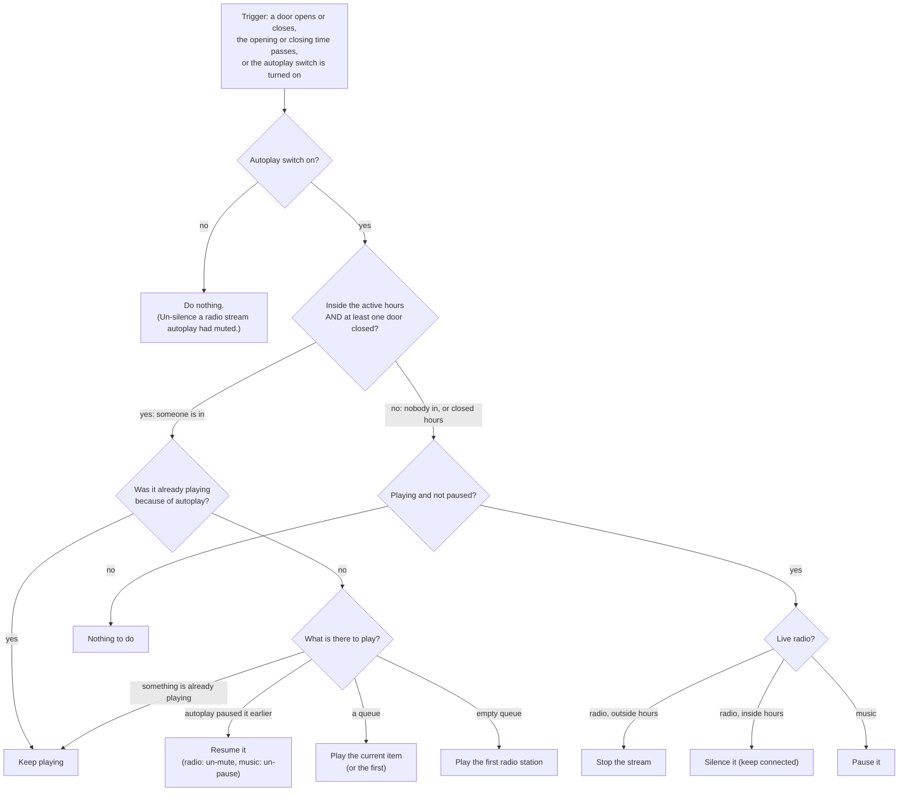

# Door autoplay

When the **Play the queue while in use** switch is on, the door sensors control playback during the opening hours:
music plays while someone is inside and pauses when nobody is. Wiring is in [Door sensor hardware](hardware.md);
the spoken messages are in [Door announcements](announcements.md).

Code: [piplayer/bathrooms.py](../../piplayer/bathrooms.py).

## The rule

Each time something changes (a door, the clock, or the switch) the app asks one question:

## What happens

| Situation | What happens |
|---|---|
| A door closes (someone enters) and nothing is playing | Plays the queue from the current item, or the first one. If the queue is empty it plays the first radio station. |
| A door closes and the music was paused by autoplay | **Resumes** it. |
| Both doors are open (nobody inside) | **Pauses** whatever is playing. |
| One door is still closed | Keeps playing. |
| The closing time passes | Pauses (music) or **stops** (radio, so it does not stream all night). |
| You switch autoplay **on** while both doors are open and music is playing | Pauses immediately. |
| You switch autoplay **off** | A radio stream that autoplay had silenced is un-silenced. Nothing else is touched from then on. |

**Autoplay reacts to changes only**: a door opening or closing, the opening or closing time, or the switch being
turned on. Between changes it leaves playback alone, so pressing Play or Pause yourself is respected until the next
change. If you pick a different track while autoplay has the music paused, it will not resume the old one.

## Live radio is silenced, not paused

A really paused internet-radio stream is dropped by the server after about a minute and takes about 4 seconds to
reconnect. So autoplay keeps the stream connected and **mutes** it. When someone comes back it unmutes instantly, and
the audio is live (not stale). The page shows it as *Paused*, and the state's `held` flag is true. YouTube,
YouTube Music and SoundCloud tracks are paused normally and continue from the same position.

The **first** visit after a restart, or after you press Stop, starts the stream from nothing and takes about 4
seconds before you hear it. Every visit after that resumes instantly.

## Fade in

When a door closing **starts or resumes** the music (the first two rows above), the volume first drops to about 8 %
of your level and then rises to it over the *Fade in* time, instead of the music blasting in. The rise starts gently
and speeds up, because loudness is felt logarithmically (a straight line sounds like a jump at the start). The
volume you had set is remembered and restored:

- If the door opens again halfway, the music pauses and the volume goes back to your level (so the next visit fades in
  again from the start).
- If you move the volume slider yourself during a fade, the fade stops and your value is kept.
- Set *Fade in* to **Off** to start at full volume at once. It applies to music and radio alike (it changes the Pi's output volume).

Range: 0 to 60 seconds, default 5. The Settings page offers Off or 3 to 60 seconds.

## Fade out

When the **last door opens**, the music no longer cuts off: the volume falls to about 8 % over the *Fade out* time
(default 3 seconds), the music pauses (live radio is silenced), and the volume is put back to your level, ready for
the next visit's fade-in.

- If someone closes a door again during the fade-out, it is cancelled and the music carries on at your volume.
- If you move the volume slider during it, the music pauses at once and your value is kept.
- Set *Fade out* to **Off** to pause instantly. When the closing time passes the music fades out the same way.

Range: 0 to 60 seconds, default 3. The Settings page offers Off or 1 to 15 seconds.

## Active hours

Autoplay, announcements and the watchdog use the **From** and **Until** times (24-hour `HH:MM`, default `08:00` to
`18:00`, in the Pi's local time zone). A range where From is later than Until means overnight. The ticker re-checks
every 20 seconds, so the closing time is applied within about 20 seconds. Check the Pi's time zone with
`timedatectl`; a wrong time zone shifts all of this.

## Why didn't it play or pause?

| Symptom | Cause and fix |
|---|---|
| Cards change but music does not | The switch is off, the time is outside the active hours, or you changed playback yourself since the last door change. |
| Music you started by hand keeps playing with both doors open | Autoplay acts when a door **changes** (or when the switch is turned on). Open or close a door, or toggle the switch, and it pauses. |
| Music did not start when someone went in, and the queue is empty | It plays the first radio station when the queue is empty. If that station's stream is dead, nothing is heard; fix the station. |
| Music paused while someone is still inside | Both doors read open: a sensor is wired wrong, a magnet slipped, or someone propped the door open. |
| Music starts at the wrong time of day | Check the active hours and the Pi's time zone. |
| It resumed the wrong thing | If you picked a different track while autoplay had paused the music, autoplay does not resume the old one; it only leaves the new one alone. |
| Radio stays silent after turning autoplay off | Press play, or toggle: turning autoplay off un-silences a stream that autoplay had muted. |

All settings: [Restrooms and Settings](../guide/restrooms-and-settings.md#settings). API fields (`autoplay`, `from`,
`to`, `fade`, `fadeout`): [`POST /api/doors`](../reference/api.md#post-apidoors).
