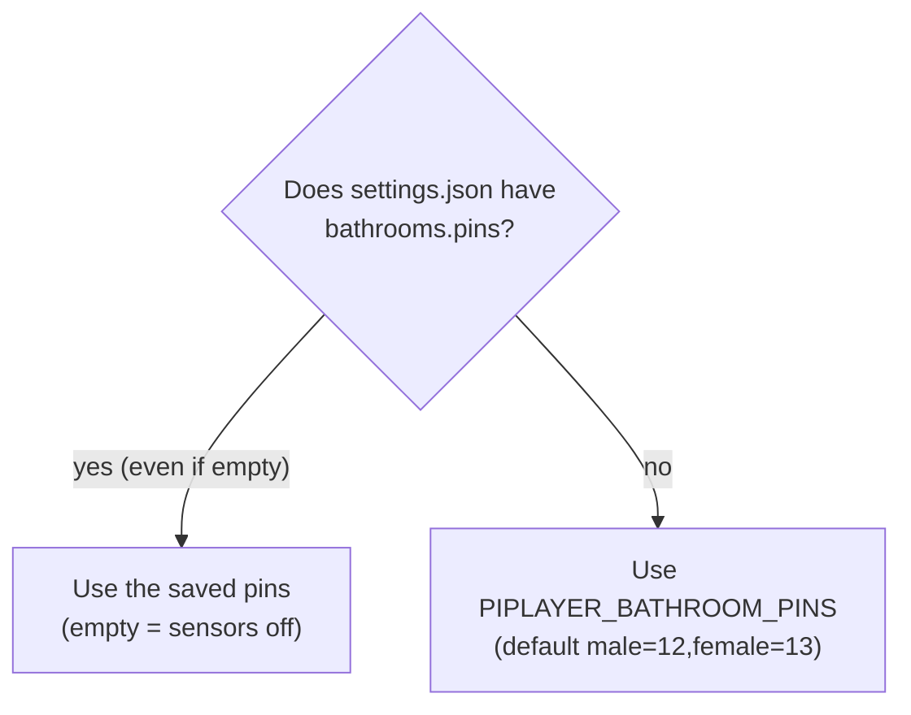

# Configuration

Configuration lives in three places:

1. **Environment variables** (`PIPLAYER_*`), read once at start-up. Set by hand or in the systemd unit.
2. **Settings changed in the web UI** (door sensors, announcements), stored in `data/settings.json`. They survive restarts.
3. **Data you build up** (stations, playlists, history, the queue), stored as JSON files in `data/`. See [Data files](data-files.md).

## Environment variables

| Variable | Default | Meaning |
|---|---|---|
| `PIPLAYER_HOST` | `0.0.0.0` | Address `python -m piplayer` listens on. `127.0.0.1` makes it local-only. (In production gunicorn's `--bind` in the unit decides.) |
| `PIPLAYER_PORT` | `8088` | Port for `python -m piplayer` (development). In production gunicorn binds the port in the systemd unit (`--bind 0.0.0.0:80`). |
| `PIPLAYER_DATA` | `./data` (next to the project) | Folder holding the JSON data files. Created if missing. |
| `PIPLAYER_MPV` | `mpv` | mpv command. May include arguments, e.g. `mpv --audio-device=alsa/plughw:2`. Parsed like a shell command line. |
| `PIPLAYER_SOCKET` | `/tmp/piplayer-mpv.sock` | Unix socket for the mpv IPC. Change it to run two instances side by side. |
| `PIPLAYER_BATHROOM_PINS` | `male=12,female=13` | **Initial** door sensor pins as `room=BCM,room=BCM`. An empty value (`PIPLAYER_BATHROOM_PINS=`) means no sensors. Pins saved from the Settings page take precedence. |
| `PIPLAYER_CHARTS_COUNTRY` | `MY` | Country of the trending chart (Music > Trending now and Suggested). Use a two-letter code such as `SG`, or `ZZ` for global. |
| `PIPLAYER_ALLOWED_HOSTS` | (none) | Extra comma-separated hostnames the API accepts. IPs, `localhost`, `*.local` and bare names such as `cytrondj` are always accepted; anything else gets 403 (this blocks DNS-rebinding). Set it if you reach the Pi by a real domain name. |
| `PIPLAYER_TTS` | (on) | Set to `off` to disable spoken announcements entirely (the test suite does). |
| `PIPLAYER_PIPER_VOICE` | `data/voices/en_GB-alan-medium.onnx` | Path of the default Piper voice (needs its `.onnx.json` next to it). Piper is used whenever this file and `piper-tts` exist. |
| `PIPLAYER_VOICE_DIR` | `data/voices` | Where Piper voice files live (every `.onnx` here appears in Settings > Voice). |
| `PIPLAYER_SPEECH_CACHE` | `data/speech-cache` | Where rendered messages are cached (the newest 30 are kept). |
| `PIPLAYER_TTS_VOICE` | `en-us+f3` | The espeak-ng voice (the fallback engine). `espeak-ng --voices` lists them; `+f1`..`+f5` and `+m1`..`+m7` pick a variant. |

Other variables the service relies on (set in [deploy/piplayer.service](../../deploy/piplayer.service)):

| Variable | Why |
|---|---|
| `XDG_RUNTIME_DIR=/run/user/1000` | Lets mpv reach the user's PipeWire session. Needs `sudo loginctl enable-linger pi`. |
| `LG_WD=/tmp` | The `lgpio` library creates a notification pipe (`.lgd-nfy*`) in its working directory; this keeps it out of the project folder. |

How to set them: in the unit add `Environment=NAME=value` and run `sudo systemctl daemon-reload && sudo systemctl restart piplayer`;
by hand put them before the command (`PIPLAYER_PORT=8099 .venv/bin/python -m piplayer`).

### How pins are chosen



So the environment variable only sets the starting point. After you press **Save** in Settings the saved value wins.
To go back to the environment's pins, delete the `bathrooms.pins` key (or the whole `settings.json`) while the service
is stopped.

## `settings.json`

Door and announcement settings, written by the Settings page. Edit by hand only with the service stopped.

```json
{
  "volume": 62,
  "bathrooms": {
    "pins": { "male": 12, "female": 13 },
    "autoplay": false,
    "from": "08:00",
    "to": "18:00"
  }
}
```

| Key | Default | Meaning |
|---|---|---|
| `bathrooms.pins` | absent (use the environment) | BCM pin per room. `{}` = sensors off. |
| `bathrooms.autoplay` | `false` | Door autoplay switch. |
| `bathrooms.from`, `bathrooms.to` | `08:00`, `18:00` | Opening hours (24-hour `HH:MM`). |
| `bathrooms.fade` | `5` | Seconds for the music to rise to your volume when a door starts it (`0` = off, max 60). |
| `bathrooms.fadeout` | `3` | Seconds for the music to fade down before it pauses when the last door opens (`0` = off, max 60). |
| `bathrooms.announce` | `true` | Speak at the doors. |
| `bathrooms.idle` | 30 | Music level (%) while nobody is in; 0 = pause. |
| `bathrooms.bye` | "Thank you for visiting. See you again soon!" | Spoken when a door opens. |
| `bathrooms.reminder_delay` | 60 | Seconds after the welcome before the reminder is spoken (0-3600). |
| `bathrooms.welcome`, `bathrooms.reminder` | "Thank you for choosing Cytron DJ. Enjoy the vibe!", "Please remember to flush and keep it clean." | The spoken messages (max 160 characters, empty = none). |
| `bathrooms.duck` | `30` | Music level (%) while a message is spoken over it (100 = no dip). |
| `bathrooms.rise` | `2` | Seconds for the music to return to full volume after a message (0 = instantly). |
| `bathrooms.voice` | `""` | `""` (automatic), a Piper voice name, or `espeak-ng`. |
| `volume` | `70` | Written whenever the volume changes, but **not read back**: the player always starts at 70 and sets the Pi's system volume to it. To change the starting level, edit `DEFAULT_VOLUME` in [player.py](../../piplayer/player.py). |

The same fields (except `volume`) are accepted by [`POST /api/doors`](api.md#post-apidoors) with validation.

## Dependencies

[requirements.txt](../../requirements.txt) lists the Python packages installed into the virtual environment.
[requirements.lock](../../requirements.lock) records the exact versions that were tested (`pip freeze --local`).

| Package | Used for |
|---|---|
| `flask` | HTTP routing |
| `gunicorn` | Production server (one worker, threads) |
| `ytmusicapi` | YouTube Music search, related tracks and charts |
| `yt-dlp` | Searching YouTube and SoundCloud, and resolving YouTube / SoundCloud / YouTube Music items to a direct audio URL. Must stay current; see [Maintenance](../admin/maintenance.md#updating-yt-dlp). |
| `piper-tts` | Natural offline voice for door announcements (needs a voice file). |
| `pytest` (development only) | The test suite. |

System packages installed with `apt`:

| Package | Used for |
|---|---|
| `mpv` | The audio player |
| `ffmpeg` | Encodes the "Listen on this device" stream (optional) |
| PipeWire tools (`pw-record`, `pw-play`, `wpctl`) | Capturing output for Listen, playing announcements, setting the system volume. Present on Raspberry Pi OS Bookworm. |
| `python3-gpiozero`, `python3-lgpio` | Door sensors. The virtual environment must be created with `--system-site-packages` (or have `include-system-site-packages = true` in `.venv/pyvenv.cfg`). |
| `quickjs` | JavaScript runtime that yt-dlp needs for YouTube. The Raspberry Pi OS `nodejs` (v20) is too old: yt-dlp needs Node 22+, Deno or QuickJS. |
| `espeak-ng` | Fallback voice for announcements (optional). |

## Limits and defaults at a glance

| Thing | Value |
|---|---|
| Starting volume | 70 % (system volume) |
| Listen streams at once | 4 (128 kbit/s MP3) |
| Radio reconnect attempts | 3, waiting 2, 4, 6 s |
| mpv restart backoff | 1 s, doubling to 30 s; auto-resume stops after more than 3 crashes in 60 s |
| History kept | newest 300 YouTube Music tracks |
| URL caches | YouTube and YouTube Music 3 h; SoundCloud 30 min; related tracks 10 min; trending chart 1 h |
| Playlist name | 80 characters |
| Door message | 160 characters |
| Search results | up to 20 per source |
| Event stream keep-alive | every 15 s |
| Sensor watchdog | 4 h of opening time without a change |
| Door ticker | every 20 s |
| Settings write delay | 1 s after the last change (and on exit) |
| Server threads | 32 (one worker) |
